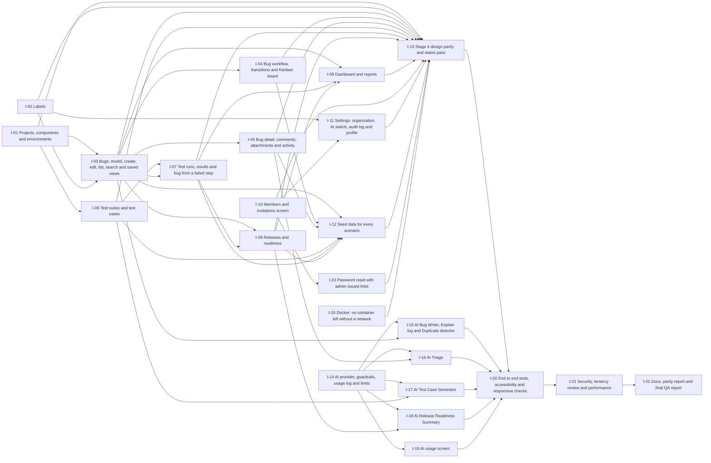

# Issue DAG for Stages 4 to 6

Generated by `scripts/build_issues.py`; edit that file, not this one. Status is updated as issues are done.

Issues in the same batch can run in parallel; a batch starts when the issues it depends on are done.

## Batches

| Batch | Stage | Issues (parallel) | Depends on |
|---|---|---|---|
| 4A | 4 | [I-01](I-01-projects-components-and-environments.md) Projects, components and environments, [I-02](I-02-labels.md) Labels, [I-10](I-10-members-and-invitations-screen.md) Members and invitations screen, [I-24](I-24-docker-no-container-left-without-a-network.md) Docker: no container left without a network | Stage 3 foundations |
| 4B | 4 | [I-03](I-03-bugs-model-create-edit-list-search-and-saved-vie.md) Bugs: model, create, edit, list, search and saved views, [I-06](I-06-test-suites-and-test-cases.md) Test suites and test cases, [I-11](I-11-settings-organization-ai-switch-audit-log-and-pr.md) Settings: organization, AI switch, audit log and profile, [I-23](I-23-password-reset-with-admin-issued-links.md) Password reset with admin issued links | I-01, I-02, I-10 |
| 4C | 4 | [I-04](I-04-bug-workflow-transitions-and-kanban-board.md) Bug workflow, transitions and Kanban board, [I-05](I-05-bug-detail-comments-attachments-and-activity.md) Bug detail: comments, attachments and activity, [I-07](I-07-test-runs-results-and-bug-from-a-failed-step.md) Test runs, results and bug from a failed step | I-03, I-06 |
| 4D | 4 | [I-08](I-08-releases-and-readiness.md) Releases and readiness | I-03, I-07 |
| 4E | 4 | [I-09](I-09-dashboard-and-reports.md) Dashboard and reports, [I-12](I-12-seed-data-for-every-scenario.md) Seed data for every scenario | I-03, I-04, I-05, I-06, I-07, I-08 |
| 4F | 4 | [I-13](I-13-stage-4-design-parity-and-states-pass.md) Stage 4 design parity and states pass | I-01, I-02, I-03, I-04, I-05, I-06, I-07, I-08, I-09, I-10, I-11, I-12, I-23, I-24 |
| 5A | 5 | [I-14](I-14-ai-provider-guardrails-usage-log-and-limits.md) AI provider, guardrails, usage log and limits | Stage 3 foundations |
| 5B | 5 | [I-15](I-15-ai-bug-writer-explain-log-and-duplicate-detector.md) AI Bug Writer, Explain log and Duplicate detector, [I-16](I-16-ai-triage.md) AI Triage, [I-17](I-17-ai-test-case-generator.md) AI Test Case Generator, [I-18](I-18-ai-release-readiness-summary.md) AI Release Readiness Summary, [I-19](I-19-ai-usage-screen.md) AI usage screen | I-03, I-05, I-06, I-08, I-14 |
| 6A | 6 | [I-20](I-20-end-to-end-tests-accessibility-and-responsive-ch.md) End to end tests, accessibility and responsive checks, [I-21](I-21-security-tenancy-review-and-performance.md) Security, tenancy review and performance | I-13, I-15, I-16, I-17, I-18, I-19 |
| 6B | 6 | [I-22](I-22-docs-parity-report-and-final-qa-report.md) Docs, parity report and final QA report | I-21 |

## Status

| Issue | Status | Commit |
|---|---|---|
| I-01 | Done | 53bbea8, 82dd4f7 |
| I-02 | Done | 8199178, 4ef3d92, 9749945, 30a3319, ce8a9d2 |
| I-03 | Done | 6b29711, 9668292, 1a9d8c2, d2fee0b |
| I-04 | Planned |  |
| I-05 | Planned |  |
| I-06 | Planned |  |
| I-07 | Planned |  |
| I-08 | Planned |  |
| I-09 | Planned |  |
| I-10 | Done | 870e66a, 1e226d1, d4d776d, 111036e |
| I-11 | Planned |  |
| I-12 | Planned |  |
| I-13 | Planned |  |
| I-23 | Planned |  |
| I-24 | Done | 562a4be, c1d81e2, b7db68a, af5eaec |
| I-14 | Planned |  |
| I-15 | Planned |  |
| I-16 | Planned |  |
| I-17 | Planned |  |
| I-18 | Planned |  |
| I-19 | Planned |  |
| I-20 | Planned |  |
| I-21 | Planned |  |
| I-22 | Planned |  |

## Requirement coverage

56 requirements are referenced by Stage 4 to 6 issues: REQ-006, REQ-008, REQ-009, REQ-010, REQ-011, REQ-012, REQ-013, REQ-014, REQ-015, REQ-016, REQ-017, REQ-018, REQ-019, REQ-020, REQ-021, REQ-022, REQ-023, REQ-024, REQ-025, REQ-026, REQ-027, REQ-028, REQ-029, REQ-030, REQ-031, REQ-032, REQ-033, REQ-034, REQ-035, REQ-036, REQ-037, REQ-038, REQ-039, REQ-040, REQ-041, REQ-042, REQ-043, REQ-044, REQ-045, REQ-046, REQ-047, REQ-048, REQ-049, REQ-050, REQ-051, REQ-052, REQ-053, REQ-055, REQ-056, REQ-057, REQ-058, REQ-059, REQ-060, REQ-061, REQ-062, REQ-063.
Requirements fully delivered in Stage 3 (auth, orgs, invitations API, audit API, platform) are verified in the Stage 3 review.
