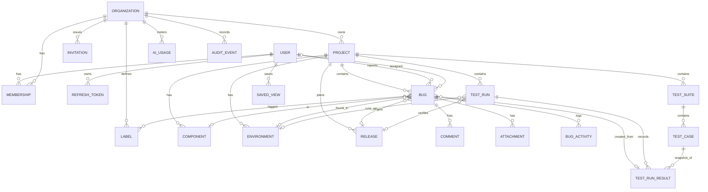
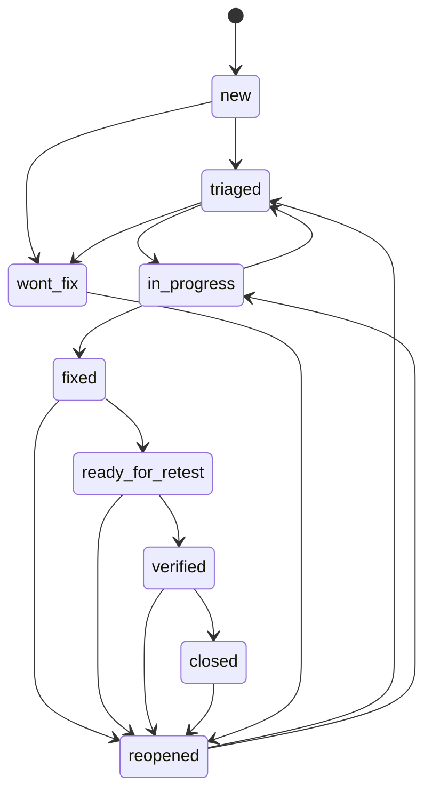

# Domain Model

All ids are UUIDs. All timestamps are UTC (D-024). Every tenant owned table has a non null `org_id` and an index that starts with `org_id`. Columns `created_at` and `updated_at` exist on every table and are not repeated below.

## 1. Entities

### 1.1 Identity and tenancy (modules `auth`, `orgs`)

| Entity | Fields | Notes |
|---|---|---|
| **User** | id, email (unique, lowercased), full_name, password_hash, is_active, last_login_at | Not tenant owned; joined to orgs through Membership |
| **RefreshToken** | id, user_id, token_hash (unique), expires_at, revoked_at, replaced_by_id, user_agent | Rotation chain (D-010) |
| **Organization** | id, name, slug (unique), ai_enabled (default true), ai_daily_limit (default 500), created_by_id | The tenant |
| **Membership** | id, org_id, user_id, role (`org_admin`, `qa_lead`, `qa_engineer`, `developer`, `viewer`), status (`active`, `removed`) | Unique (org_id, user_id) |
| **Invitation** | id, org_id, email, role, token_hash (unique), invited_by_id, expires_at, accepted_at, accepted_by_id, revoked_at | Single use (D-011) |

### 1.2 Projects (module `projects`)

| Entity | Fields | Notes |
|---|---|---|
| **Project** | id, org_id, name, key (2 to 6 uppercase), description, archived_at, next_bug_number (default 1) | Unique (org_id, key) |
| **Component** | id, org_id, project_id, name, description | Unique (project_id, name) |
| **Environment** | id, org_id, project_id, name, sort_order | Defaults dev, staging, prod |
| **Label** | id, org_id, name, color (token name) | Unique (org_id, name) |

### 1.3 Bugs (module `bugs`)

| Entity | Fields | Notes |
|---|---|---|
| **Bug** | id, org_id, project_id, number, title, description, steps_to_reproduce (list of strings), expected_result, actual_result, severity, priority, status, component_id, environment_id, reporter_id, assignee_id, release_id, source_run_result_id, ai_assisted (bool), status_changed_at, resolved_at, closed_at, deleted_at | Key is `{project.key}-{number}`; unique (project_id, number) |
| **BugLabel** | bug_id, label_id, org_id | Join table |
| **Comment** | id, org_id, bug_id, author_id, body, edited_at, deleted_at | |
| **Attachment** | id, org_id, bug_id, uploaded_by_id, filename, content_type, size_bytes, storage_key | File on local volume (D-009) |
| **BugActivity** | id, org_id, bug_id, actor_id, kind (`created`, `field_changed`, `status_changed`, `assigned`, `commented`, `attachment_added`, `attachment_removed`, `linked_release`), field, old_value, new_value | Timeline (REQ-025) |
| **SavedView** | id, org_id, user_id, name, filters (JSON) | Private (D-017) |

### 1.4 Test management (module `testing`)

| Entity | Fields | Notes |
|---|---|---|
| **TestSuite** | id, org_id, project_id, name, description, component_id, deleted_at | |
| **TestCase** | id, org_id, suite_id, title, preconditions, steps (list of {action, expected}), tags (list), priority, case_type (`positive`, `negative`, `edge`), ai_generated (bool), deleted_at | |
| **TestRun** | id, org_id, project_id, name, environment_id, release_id, status (`in_progress`, `completed`), created_by_id, started_at, completed_at | |
| **TestRunResult** | id, org_id, run_id, case_id, case_title (snapshot), steps (snapshot), result (`untested`, `pass`, `fail`, `blocked`, `skipped`), failed_step_index, actual_result, note, executed_by_id, executed_at | Snapshot keeps history stable (REQ-032) |

### 1.5 Releases (module `releases`)

| Entity | Fields | Notes |
|---|---|---|
| **Release** | id, org_id, project_id, name (version), description, target_date, status (`planned`, `in_progress`, `released`), released_at, ai_summary (text, accepted only), ai_summary_at, ai_summary_by_id | Readiness is computed, not stored (D-014) |

### 1.6 AI and audit (modules `ai`, `audit`)

| Entity | Fields | Notes |
|---|---|---|
| **AIUsage** | id, org_id, user_id, feature (`bug_writer`, `explain_log`, `triage`, `duplicates`, `test_cases`, `release_summary`), provider, model, status (`ok`, `invalid_output`, `error`, `rate_limited`, `fallback`), input_tokens, output_tokens, latency_ms, outcome (`accepted`, `edited`, `discarded`, null) | No prompt text (D-018) |
| **AuditEvent** | id, org_id (nullable for auth events before org), actor_id, action, entity_type, entity_id, data (JSON, no secrets), ip, request_id | Append only |

## 2. Relationships (ER diagram)

## 3. Enumerations

| Enum | Values |
|---|---|
| Severity | `critical`, `high`, `medium`, `low` |
| Priority | `p1`, `p2`, `p3`, `p4` |
| Bug status | `new`, `triaged`, `in_progress`, `fixed`, `ready_for_retest`, `verified`, `closed`, `reopened`, `wont_fix` |
| Open statuses | every status except `verified`, `closed`, `wont_fix` |
| Run result | `untested`, `pass`, `fail`, `blocked`, `skipped` |
| Run status | `in_progress`, `completed` |
| Release status | `planned`, `in_progress`, `released` |
| Readiness | `ready`, `at_risk`, `blocked` |

## 4. Bug state machine (D-005, D-006)

### Allowed transitions and who may perform them

Org Admin and QA Lead may perform every transition below. The table lists the additional roles.

| From | To | Also allowed for | Meaning |
|---|---|---|---|
| new | triaged | QA Engineer | Severity and priority confirmed |
| new | wont_fix | (Admin, Lead only) | Rejected at triage |
| triaged | in_progress | Developer (assignee) | Work started |
| triaged | wont_fix | (Admin, Lead only) | Decided not to fix |
| in_progress | fixed | Developer (assignee) | Code fix done |
| in_progress | triaged | Developer (assignee) | Handed back to backlog |
| fixed | ready_for_retest | Developer (assignee) | Fix deployed to a test environment |
| fixed | reopened | QA Engineer | Fix found not to work before deploy |
| ready_for_retest | verified | QA Engineer | Retest passed |
| ready_for_retest | reopened | QA Engineer | Retest failed |
| verified | closed | QA Engineer | Done |
| verified | reopened | QA Engineer | Regression found |
| closed | reopened | QA Engineer | Came back |
| wont_fix | reopened | (Admin, Lead only) | Decision reversed |
| reopened | triaged | (Admin, Lead only) | Back to triage |
| reopened | in_progress | Developer (assignee) | Work restarted |

Rules:
* "Developer (assignee)" means the developer is the bug's assignee, or the bug is unassigned, in which case the move self assigns it (D-006). A bug assigned to someone else returns 403.
* Viewer may perform no transition.
* A transition not in the table returns `409 invalid_transition` with `details.allowed` listing valid targets.
* Side effects: `status_changed_at` set on every move; `resolved_at` set on entering `fixed` or `wont_fix`; `closed_at` set on `closed`; both cleared on `reopened`. Every move writes a BugActivity and an AuditEvent.
* Moving to `in_progress` with no assignee assigns the acting user when that user is a Developer.
* Developers may also self assign an unassigned bug without changing its status (`PATCH` with their own id as `assignee_id`).

## 5. Other workflows

**Test run:** created `in_progress` with every result `untested`. Results can change while `in_progress`. `completed` freezes results. A run cannot be reopened in v1.

**Release:** `planned` to `in_progress` to `released` (Admin, Lead). `released` sets `released_at`. Readiness is advisory; a Lead may release a Blocked release, and the audit event records the readiness at that moment.

**Invitation:** pending to accepted, revoked or expired. Only pending invitations can be accepted.

**Membership:** active to removed. The last active Org Admin cannot be removed or demoted (D-022).

## 6. Audit events

| Action | When |
|---|---|
| `auth.register`, `auth.login`, `auth.login_failed`, `auth.logout`, `auth.password_changed`, `auth.refresh_reuse_detected` | Identity events |
| `org.created`, `org.settings_updated` | Org lifecycle and AI on or off |
| `member.role_changed`, `member.removed`, `invitation.created`, `invitation.revoked`, `invitation.accepted` | Access changes |
| `project.created`, `project.updated`, `project.archived` | Projects |
| `bug.created`, `bug.updated`, `bug.status_changed`, `bug.deleted`, `bug.assigned` | Bugs |
| `attachment.uploaded`, `attachment.deleted`, `comment.deleted` | Content |
| `suite.deleted`, `case.deleted`, `run.created`, `run.completed` | Testing |
| `release.created`, `release.status_changed`, `release.summary_accepted` | Releases |
| `ai.disabled`, `ai.enabled`, `ai.limit_changed` | AI controls |

Each event stores actor, org, entity, action, a small JSON payload without secrets, IP and request id.
