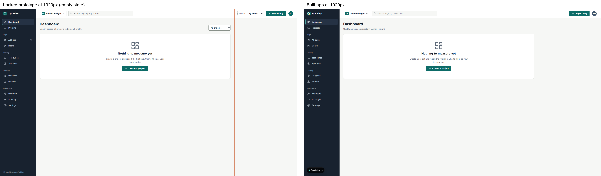

# Stage 3 Review: Foundations (repo, Docker, scaffolding, auth, data, issue plan)

**Branch:** `stage/3-foundations` | **Date:** 2026-11-17 | **Playbook gates:** 3 (repos and API boundary), 4 (issue plan), 5 (engineering foundations)

## 1. Summary

The monorepo now runs as a Docker Compose v2 stack (Postgres 16, FastAPI, Next.js), all three services with healthchecks. The backend has the full identity and tenancy layer: register, login, refresh with rotation and reuse detection, logout, profile, password change, organizations, members, invitations, role permissions from the matrix, tenant isolation on every org route, and an audit log. Alembic owns the schema. A deterministic seed CLI creates five scenarios and refuses production. The Next.js app reproduces the locked design (tokens and component styles generated from the approved prototype), has the sign in, register, workspace setup and invitation screens, the role aware app shell and the dashboard empty state. A Postman collection, a CI workflow and a 22 issue plan with a dependency graph for Stages 4 to 6 are in place.

Gate checks: stack healthy, migrations apply and roll back, seed twice gives identical counts, 143 backend tests pass, ruff and mypy strict clean, frontend lint, typecheck and build pass, Newman 55 requests and 84 assertions pass, a 16 check browser login passes, production images run as non root.

## 2. What was built

| Area | Files |
|---|---|
| Boundary and agent guide | `docs/API_BOUNDARY.md`, `AGENTS.md` |
| Docker | `docker-compose.yml`, `docker-compose.prod.yml`, `backend/Dockerfile` and `frontend/Dockerfile` (dev and prod targets, prod non root), `db/init/01-create-test-db.sql`, `.env.example`, `scripts/dc.ps1` (runs Compose through WSL, D-001) |
| Backend core | `backend/app/core/`: settings, database, error envelope, page pagination, request id and access log middleware, JSON logging, security headers, CORS, password hashing (argon2id), tokens, permission matrix, request dependencies, read only views, health |
| Backend modules | `auth`, `orgs`, `audit` with api, application, domain, infrastructure, schemas, tests; empty module skeletons for `projects`, `bugs`, `testing`, `releases`, `dashboard`, `ai` |
| Database | `backend/alembic/versions/0001_identity_tenancy_audit.py` (users, refresh tokens, organizations, memberships, invitations, audit events, check constraints) |
| Seed | `backend/app/seed/` and `docs/SEED_MANIFEST.md` |
| Frontend | `frontend/src/app` (routes, session handlers, health), `src/modules/{auth,orgs,shell,dashboard}`, `src/components/ui` (shadcn pattern), `src/lib` (typed API client, session, permissions), `src/app/globals.css` generated from the locked prototype |
| API contract | `frontend/openapi.json`, `frontend/src/lib/api/schema.d.ts` (generated), `backend/app/openapi_export.py`, `scripts/api-types.sh` |
| Postman | `postman/build_collection.py`, `postman/qa-pilot.postman_collection.json`, `postman/local.postman_environment.json` |
| CI | `.github/workflows/ci.yml`: secret scan, backend (ruff, mypy, pytest on Postgres), frontend (lint, typecheck, build), OpenAPI contract up to date, Newman on the Compose stack after migrate and seed |
| Issue plan | `docs/issues/I-01` to `I-22`, `docs/issues/DAG.md` (generated by `scripts/build_issues.py`; every endpoint contract copied from the API inventory) |
| Checks | `e2e/scripts/smoke-login.mjs` (browser), `e2e/scripts/check-mermaid.mjs` (now also renders the DAG) |

### Endpoints live in Stage 3 (21 of 97)

API-001 health; API-010 to API-016 auth; API-020 to API-031 orgs, members, invitations; API-150 audit. The other 76 are planned in `docs/issues/` (all 97 accounted for).

## 3. How to review in under 15 minutes

1. **Start** (first run builds images, about 5 minutes):
   ```powershell
   powershell -File scripts/dc.ps1 up -d --wait
   powershell -File scripts/dc.ps1 exec backend python -m app.seed --scenario baseline
   ```
   Plain equivalent where Docker is on the PATH: `docker compose up -d --wait` and `docker compose exec backend python -m app.seed --scenario baseline`.
2. **Sign in** at http://localhost:3000 with any login from `docs/SEED_MANIFEST.md`. The password is `SEED_USER_PASSWORD` in your `.env`.
   * `priya@lumenfreight.test` (QA Engineer in Lumen Freight, Viewer in Harbor Clinics): try the org switcher; the Report bug button disappears in Harbor.
   * `amara@lumenfreight.test` (Org Admin): Members and AI usage appear in the sidebar.
   * Reload the page: you stay signed in. Sign out: you land on the sign in page.
   * Try http://localhost:3000/o/tenant-a/dashboard: "Page not found" (not your workspace).
3. **API docs**: http://localhost:8000/api/v1/docs
4. **Tests yourself**:
   ```powershell
   powershell -File scripts/dc.ps1 exec backend pytest -q
   ```
5. **Plan**: read `docs/issues/DAG.md` (graph and batches), then any issue, for example `docs/issues/I-03-bugs-model-create-edit-list-search-and-saved-vie.md`.
6. **Stop**: `powershell -File scripts/dc.ps1 stop` (data kept) or `down` (containers removed, data kept in volumes).

## 4. Evidence (real output)

### Fresh clone check

Before the session restarted, a clone of `stage/3-foundations` was started as a separate Compose project (`qapilot-clean`). Its detailed logs were in that session's scratchpad, which no longer exists. What was re-verified from the running stack before it was removed with `docker compose -p qapilot-clean down -v`:

```
> docker compose -p qapilot-clean ps
SERVICE    STATUS
backend    Up 5 minutes (healthy)
db         Up 5 minutes (healthy)
frontend   Up 5 minutes (healthy)
> probes
backend /api/v1/health 200
{"status":"ok","db":"ok","version":"0.3.0"}
frontend /api/health 200
frontend /login 200
```

### Stack, migrations, seed, backend checks

```
> docker compose ps
SERVICE    STATUS
backend    Up 26 seconds (healthy)
db         Up 34 seconds (healthy)
frontend   Up 19 seconds (healthy)

> alembic current (dev database)
0001 (head)
> alembic downgrade base, then upgrade head (test database round trip)
INFO  [alembic.runtime.migration] Running downgrade 0001 -> , identity tenancy audit
INFO  [alembic.runtime.migration] Running upgrade  -> 0001, identity tenancy audit
0001 (head)

> python -m app.seed --scenario baseline   (run 1)
Seeded scenario 'baseline': organizations 2, users 15, memberships 16, invitations 2
Counts match the manifest.
> python -m app.seed --scenario baseline   (run 2)
Seeded scenario 'baseline': organizations 2, users 15, memberships 16, invitations 2
Counts match the manifest.
> APP_ENV=production python -m app.seed --scenario baseline
SEED REFUSED: Refusing to seed: APP_ENV=production. The seed is for local and test use only.
exit code 2

> ruff check .
All checks passed!
> mypy app
Success: no issues found in 91 source files
> pytest -q
.......................................................................  [100%]
143 passed in 13.87s
```

What the 143 tests cover: every protected route in the OpenAPI returns 401 without a token; every route under `/orgs/{org_id}` returns 404 `org_not_found` to an Org Admin of another org; for each endpoint, happy path, invalid input, forbidden roles, and ids from another org; the permission matrix against `PERSONAS_AND_ROLES.md`; error envelope, request id, security headers, CORS; refresh rotation, reuse detection and the 30 second race window; login throttle; last admin protection; invitation lifecycle; seed rules for all five scenarios; user and org ids reaching the access log.

The tests were shown to catch a defect: with QA Leads granted `member.update_role` at runtime, two tests failed (`test_only_admin_manages_members[qa_lead]`, `test_permission_matrix_matches_requirements[member.update_role]`).

### Frontend

```
> npm run lint
exit code 0
> npm run typecheck
exit code 0
> npm run build
✓ Compiled successfully in 1508ms
✓ Generating static pages using 11 workers (6/6) in 402ms
Route (app)
├ ○ /login
├ ƒ /o/[org]/[...section]
├ ƒ /o/[org]/dashboard
exit 0
```

### Newman (against the running stack, baseline seed)

```
newman exit code 0
│                requests │                55 │                0 │
│            test-scripts │                55 │                0 │
│              assertions │                84 │                0 │
```

### Browser login (Playwright against the running stack)

```
ok   wrong password shows the error banner
ok   QA Engineer lands on a dashboard (/o/harbor/dashboard)
ok   dashboard shows the locked empty state
ok   QA Engineer does not see Members
ok   QA Engineer sees Report bug
ok   refresh token is an httpOnly SameSite=Lax cookie on /api/session
ok   no token in localStorage or sessionStorage
ok   reload keeps the user signed in
ok   org switcher lists Harbor Clinics
ok   in Harbor Clinics Priya is a Viewer: no Report bug
ok   unknown or foreign workspace shows Page not found
ok   sign out goes to a plain sign in page (no return link to the old workspace)
ok   after sign out, app pages redirect to sign in
ok   Org Admin sees Members and AI usage
ok   no sideways scroll at 390 px (0)
ok   no page errors
PASS: 16 login checks
smoke exit code 0
```

Parity captures: `e2e/parity/stage3-dashboard-desktop.png`, `stage3-dashboard-mobile.png`, `stage3-login-error-desktop.png`. The shell matches the locked prototype; differences are listed in section 6.

### Production images

```
backend prod image built
frontend prod image built
> user inside prod images (id -u / whoami)
backend:  10001 app
frontend: 10001 app
> dev tools absent from backend prod image
pytest, ruff, mypy not installed
> image sizes
qa-pilot-frontend:prod 336MB
qa-pilot-backend:prod 366MB
```

### Contract, docs and push gate

```
> regenerate the OpenAPI contract twice
STABLE: regenerating the contract changes nothing
> python scripts/check_traceability.py
PASS: every screen maps to a REQ, every Must REQ maps to a screen, endpoint or artifact, no orphan ids, prose rule holds
> node e2e/scripts/check-mermaid.mjs
OK   DOMAIN_MODEL.md#1  OK   DOMAIN_MODEL.md#2  OK   DAG.md#1
PASS: 3 Mermaid diagrams render
> bash scripts/safe-push.sh stage/3-foundations --dry-run
ok   no .env files in any commit
ok   no secret patterns in 23 commits
DRY RUN: all checks passed, push skipped
```

### CI on GitHub (PR #2, run 44049038922)

```
conclusion=success
Backend (ruff, mypy, pytest): success
Frontend (lint, typecheck, build): success
OpenAPI contract up to date: success
Secret scan: success
Newman smoke (compose, migrate, seed): success
```

The Newman job builds the Compose stack on a clean runner, migrates, seeds twice and runs the collection, which also confirms a clean checkout starts healthy.

## 5. Decisions made in this stage

| Decision | Summary |
|---|---|
| D-037 | Sync SQLAlchemy 2.1 with psycopg 3 |
| D-038 | Exact version pins. TypeScript 5.9 and ESLint 9 instead of the newest majors. ESLint 10 was tried: rules load, but three bundled plugins only declare ESLint 9, so npm reports an invalid tree (backlog BL-007) |
| D-039 | Refresh token in an httpOnly cookie handled by Next.js session routes; 30 second window so two tabs refreshing at once do not sign the user out |
| D-040 | Tests on a real Postgres test database, schema from Alembic, rolled back per test |
| D-041 | One seed password from `SEED_USER_PASSWORD`, never committed or printed |
| D-042 | Host ports 3000, 8000, 5433; polling file watchers; the dev container uses `next dev --webpack` because Turbopack missed edits on the WSL bind mount |
| D-043 | The frontend reuses the locked prototype's CSS (generated into `globals.css`) and exposes the tokens to Tailwind 4 |

## 6. Known gaps and risks

* **Placeholders until Stage 4.** Projects, bugs, board, tests, runs, releases, reports, members, settings and AI usage show an "on its way" state in the locked empty state style. Their issues are I-01 to I-11 and I-19.
* **Parity differences on built screens:** no "Forgot password?" link (password reset is not in scope); the sidebar does not show the open bug count or "AI provider" footer yet (I-03, I-14); the prototype's "View as" role switcher is intentionally absent; Next's development indicator appears only in dev mode.
* **Members and invitations** work through the API (and Postman) but their screen arrives with I-10; invitations can be accepted in the app today (`/invite/<token>`).
* **ESLint 9 is end of life** (development tool only, D-038, BL-007).
* **Fresh clone evidence is partial**: health and probes were re-verified, but the detailed log of that run was lost with the previous session's scratchpad.
* **Docker on WSL** (RISK-01): WSL stops when idle, which stops the containers; a failed first start can leave a container without a network. Both are documented with fixes in `docs/ENVIRONMENT.md`.
* **Token storage trade off**: the access token lives in memory, so every page load costs one refresh call. This is the intended design (D-010).
* **Seed** covers people and workspaces only; domain data per scenario is I-12.

## 7. Requirements status after Stage 3

| Status | Requirements |
|---|---|
| Done and tested (API and screen) | REQ-001, REQ-002, REQ-003, REQ-004, REQ-005, REQ-010, REQ-058 |
| API done and tested; screen in Stage 4 | REQ-006 (accept screen done, invite screen I-10), REQ-009 (I-10), REQ-011 (I-11), REQ-012 (I-11), REQ-053 (I-11) |
| Cross cutting, enforced for every endpoint built so far | REQ-007, REQ-008, REQ-054, REQ-063 |
| Platform done | REQ-059 (stack healthy), REQ-060 (seed, identity data), REQ-061 (Postman, Newman, CI) |
| Planned | All others, see `docs/issues/DAG.md` |

## 8. Next stage

Stage 4, core features, in the batch order from `docs/issues/DAG.md`: 4A projects, labels, members screen; 4B bugs, test suites, settings; 4C workflow and board, bug detail, test runs; 4D releases; 4E dashboard and reports, full seed data; 4F design parity pass. Each issue ships backend endpoints with the five kinds of tests, Postman requests, seed updates and the screen matching its locked screenshot.

## 9. Changes after feedback (Stage 3 gate)

Feedback: "APPROVE Stage 3, with two UI fixes required before merging PR #2", plus a standing responsive rule (D-044).

### Bug 1: user menu opened off screen (fixed)

* **Root cause:** the prototype's `.menu { position: absolute }` collapsed the Radix positioning wrapper to zero width, so the menu started at the avatar and ran past the right edge (at 1440 px it spanned 1416 to 1616). Every Radix menu was affected; the workspace menu only escaped because it opens from the left.
* **Fix:** `frontend/src/app/app.css` lets the Radix wrapper position the menu; `DropdownMenuContent` now uses `collisionPadding` 8 px with edge alignment (the user menu is anchored to the avatar's right edge and flips or shifts to stay inside); menus are at most 320 px wide, never wider than the screen less 16 px, and long names wrap inside them.
* **Other popups checked:** workspace menu, user menu and the mobile navigation drawer at every width. The app has no tooltips or modals yet; the check covers them as they arrive (D-044).

### Bug 2: dashboard empty state narrower than the content area (not changed, your decision needed)

The locked prototype caps the content area at 1280 px (`--content-max` in `design/TOKENS.md`) and aligns it left. At 1440 px the panel fills the area (1160 px in both); at 1920 px it is 1232 of 1688 px (73%) in both, which is the gap you saw. The app matches the prototype pixel for pixel, so, as you asked, nothing was changed (D-046).



Also at [1440 px](../../e2e/parity/stage3-fix/compare/dashboard-empty-1440-prototype-vs-app.png). The red line marks the 1280 px cap. The prototype's "All projects" filter is not built yet (it comes with the metrics in I-09).

### Found by the new checks and fixed

| Problem | Root cause | Fix |
|---|---|---|
| Inputs and selects were 37 px tall on touch widths (prototype: 44 px) | My Stage 3 one off generator for `globals.css` dropped every line mentioning the prototype only `.role-switch`, including the shared rule `.input, .select, ..., .role-switch select { height: 44px }` | New committed generator `scripts/build_globals_css.py` strips prototype only selectors one by one; CI fails if `globals.css` drifts from the prototype |
| Avatar and workspace badge initials were 10 to 11 px | Prototype sizes below the 12 px floor of the new rule | Prototype updated to 12 px (board card avatar 22 to 24 px to fit), CSS regenerated, locked screenshots recaptured; design validation still passes |
| A long workspace name could stretch the header switcher | No truncation | Name truncates with an ellipsis (full name in a tooltip) in the prototype and the app |

### Standing rule, automated (D-044)

`e2e/scripts/check-app-layout.mjs` checks every built page (sign in, register, invitation, workspace setup, dashboard, section placeholders, 404) and every popup at 360, 390, 768, 1024, 1280, 1440, 1920 px and 200% zoom (emulated as half width at device scale 2), signed in as the Org Admin and as a fixture person with a very long name, email and workspace name. It fails on: page sideways scroll; any element outside the screen unless inside its own scroll container; a popup cut off or within 4 px of the edge; clipped text that is not a deliberate ellipsis; text under 12 px; tap targets under 44 px at 1024 px and below. It runs in CI as the new job "Responsive and popup checks", which also runs the browser login smoke and uploads the screenshots.

Before (fixes stashed, same checker) and after:

```
before: Checked 131 screen and popup states at 360, 390, 768, 1024, 1280, 1440, 1920, 1280-zoom200, 1920-zoom200
        FAIL: 92 problem(s)    (user menu cut off at all 9 settings, 37 px inputs, 10 to 11 px initials)
after:  Checked 131 screen and popup states at 360, 390, 768, 1024, 1280, 1440, 1920, 1280-zoom200, 1920-zoom200
        PASS: nothing outside the screen, no popup cut off, no clipped or tiny text, 44 px targets on touch widths
        (run twice, both passed)
```

| Width | Problems before | User menu before | Problems after | User menu after | Screenshots |
|---|---|---|---|---|---|
| 360 | 28 | cut off | 0 | ok | [before](../../e2e/parity/stage3-fix/before/user-menu-360.png), [after](../../e2e/parity/stage3-fix/after/user-menu-360.png) |
| 390 | 28 | cut off | 0 | ok | [before](../../e2e/parity/stage3-fix/before/user-menu-390.png), [after](../../e2e/parity/stage3-fix/after/user-menu-390.png) |
| 768 | 39 | cut off | 0 | ok | [before](../../e2e/parity/stage3-fix/before/user-menu-768.png), [after](../../e2e/parity/stage3-fix/after/user-menu-768.png) |
| 1024 | 36 | cut off | 0 | ok | [before](../../e2e/parity/stage3-fix/before/user-menu-1024.png), [after](../../e2e/parity/stage3-fix/after/user-menu-1024.png) |
| 1280 | 24 | cut off | 0 | ok | [before](../../e2e/parity/stage3-fix/before/user-menu-1280.png), [after](../../e2e/parity/stage3-fix/after/user-menu-1280.png) |
| 1440 | 24 | cut off | 0 | ok | [before](../../e2e/parity/stage3-fix/before/user-menu-1440.png), [after](../../e2e/parity/stage3-fix/after/user-menu-1440.png) |
| 1920 | 24 | cut off | 0 | ok | [before](../../e2e/parity/stage3-fix/before/user-menu-1920.png), [after](../../e2e/parity/stage3-fix/after/user-menu-1920.png) |
| 1280-zoom200 | 28 | cut off | 0 | ok | [before](../../e2e/parity/stage3-fix/before/user-menu-1280-zoom200.png), [after](../../e2e/parity/stage3-fix/after/user-menu-1280-zoom200.png) |
| 1920-zoom200 | 39 | cut off | 0 | ok | [before](../../e2e/parity/stage3-fix/before/user-menu-1920-zoom200.png), [after](../../e2e/parity/stage3-fix/after/user-menu-1920-zoom200.png) |

All before and after screenshots (user menu, workspace menu, dashboard, sign in, long names, navigation drawer) at every width: `e2e/parity/stage3-fix/INDEX.md`.

### Other checks after the fixes

```
> scripts/validate-design.ps1
PASS: every screen maps to a REQ, every Must REQ maps to a screen, endpoint or artifact, no orphan ids, prose rule holds
PASS: no script errors, role rules hold, no element wider than the screen, no clipped or overlapping text, 44 px tap targets up to 1024 px, no serious or critical axe violations
PASS: 100 valid local screenshots; GitHub links not checked
DESIGN VALIDATION PASSED
> python scripts/build_globals_css.py --check
globals.css matches the prototype
```

CI for the updated PR: see section 10.

### Carried into the plan

| Item | Where |
|---|---|
| Password reset ("Forgot password?") | D-045 (admin issued single use links, no email in v1), issue I-23 (Stage 4, batch 4B), BL-008 |
| Root cause fix for a container left without a network | Issue I-24 (Stage 4, batch 4A), BL-009 |
| ESLint 10 upgrade | BL-007 (already logged, D-038) |
| Standing responsive rule | D-044, `CLAUDE.md`, every UI issue's test list (`scripts/build_issues.py`) |
