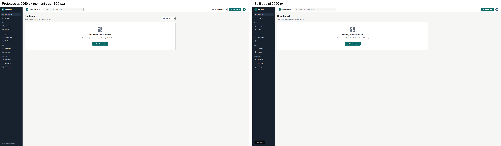

# Stage 4 Review: Core features (in progress)

**Branch:** `stage/4-core-features`

## 1. Setup tasks (before I-01, requested by the product owner)

| # | Task | Result |
|---|---|---|
| 1 | D-046 and TOKENS.md say 1552 px, matching the Stage 3 review | Both now state that the content area is at most 1600 px including 24 px padding each side, so at 1920 px the panel spans 1552 of 1688 px. No "1600 of 1688" wording remains |
| 2 | Add 2560 x 1440 to the responsive check, with a dashboard comparison at that width | Added to `e2e/scripts/check-app-layout.mjs` (and D-044, `CLAUDE.md`, the CI job name). Comparison below |
| 3 | `fillStable` records any retry as a layout problem | Every retry is reported as `form: typed text in <field> was wiped at step "<step>"`. Proven with a test only hook that wipes the field once (`QA_LAYOUT_INJECT_WIPE=1`) |
| 4 | Signing out from every signed in page lands on `/login` once and keeps typed text | New `e2e/scripts/check-signout.mjs`, added to the CI responsive job. Proven against a planted late second redirect |

### Evidence

```
> node scripts/check-app-layout.mjs --shots parity/stage4-setup/after
Checked 145 screen and popup states at 360, 390, 768, 1024, 1280, 1440, 1920, 2560, 1280-zoom200, 1920-zoom200
PASS: nothing outside the screen, no popup cut off, no clipped or tiny text, 44 px targets on touch widths

> QA_LAYOUT_INJECT_WIPE=1 node scripts/check-app-layout.mjs --only 1440     (negative test for task 3)
FAIL: 2 problem(s)
  - [1440] form: typed text in #l-email was wiped at step "sign in as the Org Admin" (attempt 1); the form was replaced after it was filled
  - [1440] form: typed text in #l-email was wiped at step "sign in as the long names fixture" (attempt 1); the form was replaced after it was filled

> node scripts/check-signout.mjs
PASS: 26 sign outs from 13 pages at 1440 and 390 px: one plain /login each, typed text kept, session ended
```

Negative test for task 4, with a second redirect planted one second after Sign out (confirmed live in the browser first, then removed and confirmed gone):

```
FAIL: 52 problem(s) in 26 sign outs
  - [1440] /o/lumen/dashboard: 2 navigations to /login after Sign out (expected exactly 1): http://localhost:3000/login, http://localhost:3000/login?again=1
  - [1440] /o/lumen/dashboard: sign in page has a query string (?again=1); expected a plain /login
```

A first attempt planted the second redirect immediately; Next.js merged both redirects into one navigation, so there was nothing a user could notice and the check rightly passed. The late redirect reproduces the real failure.

Pages covered by the sign out check: dashboard, projects, bugs, board, test suites, test runs, releases, reports, members, AI usage, settings, report a bug, and the in app 404.

### Dashboard at 2560 x 1440

Prototype and app match: the content area is capped at 1600 px, so the panel is 1552 px inside a 2328 px area (67 percent of it, left aligned).



All 2560 px app screenshots: `e2e/parity/stage4-setup/after/*-2560.png`.

## 2. Issues

I-01 and I-02 evidence is added at the end of Stage 4 (commits are listed in `docs/issues/DAG.md`). I-24 is first because every Newman and layout run depends on it.

### I-24 Docker: no container left without a network (REQ-059, D-048)

All output below was captured on 2026-11-19 on the build machine (Docker 29.4.0 in WSL 2.6.3, Ubuntu 24.04).

#### A. A taken host port, before and after

`scripts/repro-i24.sh` runs in its own throwaway Compose project (`qapilot-i24-repro`, host port 15433, its own containers, network and volumes), never in `qa-pilot`. Something else (`python3 -m http.server`) owns the port.

| | Before the fix (plain `docker compose up -d`) | After the fix (`scripts/dc-preflight.sh`) |
|---|---|---|
| Result | `up` exits 1: `failed to set up container networking: driver failed programming external connectivity` | Refused, exit 1: `port 15433 is in use by python3 (pid 1590)`, then `Nothing was started` |
| Left behind | Container `qapilot-i24-repro-db-1` in state `created`, `networks=[]`, still the same 20 seconds later (`restarts=0`) | No container for the project |

Two more cases, both as designed (D-048):

| Case | Result |
|---|---|
| The port belongs to the same Compose project | `Preflight ok`, exit 0 (up is a no-op) |
| The port belongs to another project name (another clone) | Refused, exit 1: `port 15433 is published by container qapilot-i24-repro-db-1 (Compose project qapilot-i24-repro)` |

Script result: `RESULT: PASS` (4 checks). Afterwards the throwaway project had 0 containers and 0 volumes, and the live stack was untouched. The first run of the script printed `tail`'s exit code instead of `docker compose`'s (a bug in the script, fixed; the table is from the corrected run).

What this does and does not show: it reproduces the start state of the Stage 3 incident (a failed first start leaves a container with no network). It does not reproduce the later detached start; the restart policy did not start the container within 20 seconds. The policy stays `restart: unless-stopped` because it is what brings the stack back after a WSL idle stop (below); `on-failure` would not (D-048).

#### B. WSL idle shutdown, control against held

`scripts/repro-i24-idle.ps1` brings the stack up, waits 45 seconds, then reads the journal of `docker.service`.

| Run | Wait | `docker.service` stops | Journal |
|---|---|---|---|
| Control: no WSL session during the wait | 45 s | 1 | `13:16:11 Stopping docker.service` (last `wsl` call ended 13:15:56, so 15 s later); started again at 13:16:44 by the next `wsl` call |
| Held through `scripts/with-wsl.ps1` | 49 s | 0 | none; `RESULT: Docker stayed up` |

An earlier attempt at the held run was discarded: the script passed `-NoProfile` to `with-wsl.ps1`, PowerShell read it as a parameter, the wait never ran, and the script still printed "Docker stayed up". The script now prints the elapsed time and fails when the wrapper fails.

Effect on the checks before the wrappers (Newman from Windows, no session): run 1 got health 503 and login 500 (connection refused to the database); run 2 got 26 failures in one block from the moment Docker was stopped, with no response at all; run 3 got 81 failures because the stack was down for the whole run. With a session held, the same collection passed: 103 requests, 155 assertions, 0 failed.

#### C. Backend check and the wrappers

| Check | Result |
|---|---|
| `python -m app.core.db_preflight` | Retries resolving `db` for about 30 seconds, then exits with a message naming the fix; 8 pytest tests (retry, give up after 30 s, message, no password echoed, bad URL) |
| `depends_on` db with `condition: service_healthy` | Already present on the backend (and the frontend waits for a healthy backend); nothing to add |
| Newman through `scripts/newman.ps1` (inside Docker, `newman@6.2.3`, one WSL session) | 103 requests, 155 assertions, 0 failed. Node is not installed in WSL, so a throwaway container from the frontend image is used |
| Layout check through `scripts/with-wsl.ps1` | PASS: 185 screen and popup states at 360, 390, 768, 1024, 1280, 1440, 1920, 2560, 1280 zoom 200 and 1920 zoom 200; the hold closed with no `qapilot-hold` process left |
| Ruff, mypy, pytest | Clean; clean (100 files); 243 passed |

Two bugs in `with-wsl.ps1` were found and fixed while testing it: the quoted `bash -c` string was split by `wsl.exe` and ended the hold at once (the hold is now a script file), and a one argument command was splatted as characters (`@(...)` keeps it an array).

#### D. Not done, on purpose

* The product owner's `.wslconfig` was not changed. `instanceIdleTimeout=-1` is documented in `docs/ENVIRONMENT.md` as optional and unverified against the Microsoft documentation (BL-009 keeps this open).
* The detached start after a Docker restart was not reproduced, so the restart policy conclusion rests on the 20 second observation and the idle measurements above.

### I-10 Members and invitations screen (REQ-006, REQ-009, D-049)

Frontend only: the six endpoints (API-024 to API-029) came with Stage 3 and already have happy, invalid, forbidden, `last_admin` and cross tenant tests and Postman requests. No migration, no backend change, no OpenAPI change.

#### A. What a QA Lead may see (checked before the read only view was built)

| Source | Lines |
|---|---|
| `docs/requirements/REQUIREMENTS.md` REQ-006 | "An Org Admin invites people by email and role through a copyable link." |
| `docs/requirements/REQUIREMENTS.md` REQ-009 | "An Org Admin manages members: change role, remove member." |
| `docs/requirements/PERSONAS_AND_ROLES.md` section 3.1 (columns: Org Admin, QA Lead, QA Engineer, Developer, Viewer) | `member.list` (members screen): Y, Y, N, N, N. `member.update_role`: Y, N, N, N, N. `member.remove`: Y, N, N, N, N. `invitation.create` / `invitation.revoke`: Y, N, N, N, N. `invitation.list`: Y, Y, N, N, N |
| `docs/requirements/PERSONAS_AND_ROLES.md` section 4, navigation | "Members \| Y \| Y (read only) \| N \| N \| N" |
| `docs/requirements/SCREEN_INVENTORY.md` SCR-19 | "Admin (manage), Lead (read)" |

So a QA Lead sees the members list including emails (`member.list`) and the pending invitations including their email addresses (`invitation.list`), and nothing else: no role selects, no Remove, no Invite people, no Revoke. Every other role gets the no access state. The layout check fails if the QA Lead view contains one of those controls; it did not.

#### B. Checks

| Check | Result |
|---|---|
| Ruff, mypy, pytest | Clean; clean (100 files); 243 passed |
| Newman through `scripts/newman.ps1` | 103 requests, 155 assertions, 0 failed (no new endpoints) |
| Frontend lint, typecheck, `next build` | Clean; clean; builds, `/o/[org]/members` in the route list (dev server stopped for the build and restarted) |
| Layout check through `with-wsl.ps1 -Up` | PASS, 255 states at 360, 390, 768, 1024, 1280, 1440, 1920, 2560, 1280 zoom 200 and 1920 zoom 200. New: members as Org Admin, invite dialog (form, then link), remove confirmation, no results, members as QA Lead (read only), members with the 80 character name and long email |
| `e2e/scripts/check-members-flow.mjs` | PASS: Org Admin invites, the link is shown once, a new user registers with the invited email and accepts, the member is a Developer and no longer pending, the used link no longer works, the member is removed. Test users are `flow-i10-<timestamp>@qapilot.test`; the script removes the membership and any pending invitation of that pattern (also those left by earlier failed runs). The user records stay. The script never prints the link: it is held in one variable and removed from error text |

The invite link is a secret and was kept out of everything that persists: not logged, not put in a URL by this screen, the mutation has `gcTime: 0` and is reset when the dialog closes, the dialog state is cleared on close, and a failed clipboard write selects the text instead. The captured screenshots mask the field. One unmasked screenshot of an earlier layout run (an invitation that the run revoked at its end) was deleted and recaptured with the mask before anything was kept.

Bugs in my own scripts found and fixed on the way: the layout check ran against a stack that was still starting (the wrapper now has `-Up`), the flow clicked a banner sentence instead of the button (`text=` matches substrings), and a race that read the first row's role instead of the new member's.

#### C. Parity with the locked screenshots (1440 x 900 and 390 x 844)

Side by side images: `e2e/parity/stage4/i10/compare/*.png` (locked on the left, app on the right); app captures in `e2e/parity/stage4/i10/app/`.

| State | Result |
|---|---|
| Default, desktop | Same layout, columns, controls and spacing. Differences are data, not layout: join dates (the dev database has 16 Nov 2026 for everyone, the prototype has 2 Mar to 21 Aug 2026), order (the API sorts by name, the prototype by seed order) and avatar colours (derived from the user id) |
| Default, mobile | Same stacked rows, same labels and controls; the same data differences |
| Invite with link | Same dialog, banner and copy row. Differences: the email and role fields are read only after the link exists (the prototype leaves them looking editable), the link is masked in the capture, and the link is the real address of this app |
| Loading | Matches after a fix: the first version used a generic line skeleton; it now uses the prototype's table skeleton (filter blocks and rows of four cells) |
| Error | Matches after a fix: the first version had no "Request id" line; the error now carries the `X-Request-ID` header, which the API already exposes. The capture answers with a mocked 500 and the request id from the locked screenshot |
| Only in the prototype | The "View as" role switcher in the header; the Next.js development indicator in the app screenshots (development mode only) |
| Deliberate deviations | A confirm dialog before Remove (D-049; the prototype removes at once); your own row is locked with an explanation (D-049); the explanation is also exposed to screen readers |
| No locked screenshot | The QA Lead read only view, the remove confirmation and the no results state: the locked set only has the Org Admin screens. They are in `e2e/parity/stage4/i10-after/` (`members-lead-*`, `members-remove-*`, `members-no-results-*`) |

Backlog: BL-012 (pager), BL-013 (leave workspace and self demotion).

### I-03 Bugs, backend part (REQ-017, REQ-018, REQ-020, REQ-021, REQ-026, REQ-027, REQ-029, REQ-041, REQ-062; D-050)

The bug list screen and the New bug form are not built yet; this section covers the migration, API-060 to API-064 and API-078 to API-080, their tests and Newman. The frontend part comes after review.

#### A. Checks

| Check | Result |
|---|---|
| Ruff, mypy | Clean; clean (110 files) |
| pytest | 392 passed (243 before; 149 new in `modules/bugs/tests/` plus 8 routes added to the contract test, which also gives every new route its 401 and cross tenant case) |
| Migration `0004_bugs` | up, down, up, and `alembic check` reports no drift. Backend recreated afterwards (head 0004). Tables `bugs`, `bug_labels`, `saved_views`; indexes `(org_id, project_id, status)`, `(org_id, assignee_id)`, `(org_id, updated_at DESC)` (NFR-PERF-04) |
| Newman through `scripts/newman.ps1` | 182 requests, 291 assertions, 0 failed (103 and 155 before; 79 requests and 136 assertions added: Bugs folder with happy, invalid, unauthorized, forbidden and cross tenant for each of the eight endpoints, the all or nothing edit, the label cascade and saved view privacy) |
| OpenAPI | `frontend/openapi.json` and `schema.d.ts` regenerated with `scripts/api-types.sh` |

What the new tests pin down: the numbering (`WEB-1`, per project and per org, a deleted bug's key never reused, 20 bugs created from 10 threads on separate connections get 1 to 20), the Developer rules (severity or priority sent gives 403 and nothing is created; one forbidden field in a PATCH rejects the whole request and nothing is applied; self assign only on an unassigned bug), the open definition against all nine statuses (Fixed and Ready for retest are open; Verified, Closed and Won't fix are not) for the list filter and for both counters, the SLA filter against the Python rule for every severity and status (144 bugs), soft delete (gone from list, search, filters, counts, GET by id and key; the row stays), the label cascade (`bug_labels` rows deleted, the bug stays, the label `bug_count` is the real count), component and environment deletes leaving the bug with none, saved view privacy (even an Org Admin does not see another person's view; another org's view is 404), and search treating `%` and `_` as plain characters.

#### B. Performance of `GET /bugs` (NFR-PERF-01: p95 under 300 ms)

Measured in a throwaway database `qapilot_perf` on the same Postgres server, with a second backend on port 8001 and 5,000 bugs (about 2 percent soft deleted), 5,802 label links, 3 projects, 12 users. The script (`.gate/perf-bugs.py`, not committed) created the database and removed it again in `finally`; it printed "throwaway database removed: yes", and the dev database was never touched. 60 runs per request after 8 warm up requests, real HTTP inside the backend container, so the numbers leave out the browser and the Windows to WSL hop.

| Request | p50 ms | p95 ms | max ms | rows matched |
|---|---|---|---|---|
| default page (25, newest first) | 13.5 | 16.2 | 18.1 | 4887 |
| page_size=100 | 17.1 | 20.2 | 51.8 | 4887 |
| page 40 of size 100 | 20.5 | 24.5 | 28.4 | 4887 |
| open bugs | 13.0 | 15.9 | 46.9 | 3885 |
| status new, triaged and severity critical, high | 11.1 | 13.9 | 15.6 | 489 |
| project and component filter | 10.2 | 14.2 | 15.3 | 143 |
| label filter | 17.9 | 20.3 | 23.4 | 129 |
| assignee filter | 10.0 | 12.6 | 13.5 | 295 |
| sort by severity | 16.8 | 23.4 | 35.8 | 4887 |
| sla_breached=true | 14.3 | 17.2 | 57.6 | 3811 |
| sla_breached=true, open, sort by priority | 14.7 | 17.4 | 19.0 | 3204 |
| search "timeout" (about 1 bug in 8) | 38.3 | 40.9 | 42.9 | 612 |
| search "shipment 12" (title substring) | 41.3 | 43.8 | 44.4 | 60 |
| search "stops responding" (description, every bug) | 39.1 | 44.3 | 47.6 | 4887 |
| search by key "web-12" | 44.0 | 54.0 | 70.3 | 108 |
| search with no match | 39.6 | 45.1 | 48.3 | 0 |
| search with filters and sort | 33.0 | 37.0 | 66.3 | 360 |

Worst p95 is 54 ms against the 300 ms limit. Search is the slowest part, about three times a filtered list, because `ILIKE '%term%'` scans the table; it is not close to the limit at this size, so no trigram index item was added to the backlog. It grows with the number of bugs in the org, so it is worth re measuring when the seed (I-12, about 60 bugs per scenario) or a real workspace gets much larger than this.

#### C. Notes for review

* One addition to API-060: the boolean `open` parameter (the "All open" saved view needs it). Multi value filters are repeated parameters (`status=new&status=triaged`) rather than `status[]` (D-050).
* `release_id` and `source_run_result_id` are stored without foreign keys until I-08 and I-07; until those modules register their check (`bugs/application/hooks.py`) any such id is refused with 422.
* Component, environment and label deletes need no hook in the bugs module: the foreign keys do the work (`SET NULL` for the first two, `CASCADE` for `bug_labels`). The I-01 `on_component_deleted` hook stays unused.
* The BL-011 Undo on the label delete toast stays out of I-03 (product owner). The Labels tab confirm will say how many bugs lose the label, using the real count, in the frontend part.

#### D. Backend addition after review: the unassigned filter (D-051)

`unassigned=true` on `GET /bugs` returns bugs nobody is assigned to (`false` the assigned ones); `assignee_id` together with `unassigned=true` is a 422, and saved view filters accept the key with the same rule. Evidence: pytest 399 passed (ruff and mypy clean), Newman 184 requests and 295 assertions, 0 failed, OpenAPI types regenerated. Commits `9668292`, `3db68b2`, `ccf7f02`.

### I-03 Bugs, frontend part (SCR-08, SCR-11; D-051)

The bug list with saved views, the New bug form and the label delete confirmation with the real count.

#### E. Checks

| Check | Result |
|---|---|
| Lint, typecheck, `next build` | Run in one off containers in WSL with the dev server stopped (not on Windows): clean; clean; builds, and the route list has `/o/[org]/bugs` and `/o/[org]/bugs/new`. The `.next` cache volume was emptied afterwards, the dev server restarted and `/login` answers 200 |
| Layout check through `with-wsl.ps1 -Up` | PASS, 445 states (was 255) at 360, 390, 768, 1024, 1280, 1440, 1920, 2560, 1280 zoom 200 and 1920 zoom 200. Screenshots in `e2e/parity/stage4/i03-after/` |
| `e2e/scripts/check-bugs-flow.mjs` | PASS: a QA Engineer reports a bug (High, P2, a label) and finds it as `LAYT-n`; a Developer reports one and the real request has no `severity`, `priority`, `release_id` or `source_run_result_id` (the bug comes back Medium and P3); the Unassigned filter lists only unassigned bugs; Status, search and More filters (priority) narrow the list; a saved view is created, applied, still applied after a reload, invisible to another person, and deleted through its confirmation; a bug key link opens the placeholder; the label delete confirmation says "It will be removed from 1 bug. The bug itself stays." and the bug keeps existing without the label |
| Backend suites | ruff and mypy clean, pytest 399 passed, Newman 184 requests and 295 assertions, 0 failed |

States added to the layout check: bug list (admin) with a 200 character title, a 158 character unbroken word, a bug with 8 labels and a 59 character component; More filters open with a project and the long component; Save view dialog and its name taken error; the long named saved view applied; delete view confirmation; no results; Past SLA badge (the API cannot backdate a bug, so the check edits the list response to show the badge); loading (response held back); error (a mocked 500 with a request id); empty workspace ("No bugs yet", in the long names workspace); the list as Developer and as Viewer (no Report bug button); New bug as Org Admin, with the error banner, with long text in every field and every label picked, as Developer (severity and priority disabled with the hint, checked) and as Viewer (no access); the delete label confirmation in Settings. The fixtures are created and removed through the API: bugs are soft deleted (the keys stay used) and the fixture project is archived again.

What the checks found and fixed on the way: the sort chevron I had rotated pointed sideways (the icon already points down); the Save view tab put its plus icon above the text; two filter changes made faster than one render could overwrite each other in the first version of the flow script (the script now waits for the URL like a person), and a search that settled late could undo a view applied after it (typing is now only written to the URL while it is still unsent). One real limit remains: two filter changes made within a single render (milliseconds apart, not possible by hand) can lose the first one.

Flow script notes: the Playwright request body of the app's `fetch(Request)` calls cannot be read, so the first version of the Developer check passed on an empty body. It now records the real body inside the page and fails if no body was read. Test views are private to each person, so a failed run left three views behind; the script now removes `flow-i03-` views of every user it signs in as through the API in `finally`, and only those (a listing script with a dry run, `.gate/views-left.mjs`, showed exactly those three before they were deleted). The failure path of that cleanup was not exercised after the change; the normal path was (0 views left).

#### F. Parity with the locked screenshots (1440 x 900 and 390 x 844)

Side by side images: `e2e/parity/stage4/i03/compare/*.png` (locked on the left, app on the right); app captures in `e2e/parity/stage4/i03/app/`.

| State | Result |
|---|---|
| Bug list, default, desktop and mobile | Same page head, view tabs, filter row, table columns, badges, key, pager. Data differs (the dev database has the Layout fixture project and the parity bugs, all New, none past SLA). Row assignee names wrap in the app when the title column is wide because of the fixture titles |
| Bug list, no results ("refund") | Same state box, title and text |
| Bug list, loading and error | Same table skeleton; same error box with the request id |
| New bug, default and error, desktop and mobile | Same fields, order and styling. The error banner lists the fields that failed (the prototype's example says project and title; the app preselects a project, so it names the title only) |
| Differences by decision | No "Critical in prod" tab (BL-016); no Export CSV button (API-133, I-09); the Status select shows "All open" instead of "Any status" because that is what the list really filters (approved); the Environment starts at None (approved); the browser's own clear button in the search box is hidden; a "More filters" button after the five controls; the search placeholder says "Search key, title or description"; the pager buttons are real; no "View as" switcher (as on Members) |
| Differences until their issues | No AI Bug Writer panel (the form is one column, 860 px wide), no duplicate warning, no file drop zone (I-15, I-05); the New bug AI and AI loading screenshots are not captured; Labels are a pick list of existing labels instead of a free text box (BL-015); Environment starts at None (the prototype starts at prod); bug key links open the "on its way" placeholder until I-05 |
| No locked screenshot | Save view and delete view dialogs, More filters row, empty workspace, Developer and Viewer forms: in `i03-after/` (`bugs-save-view-*`, `bugs-delete-view-*`, `bugs-more-filters-*`, `bugs-empty-*`, `bug-new-developer-*`, `bug-new-viewer-*`) |

Backlog: BL-015 (create a label on the spot), BL-016 (`is_production` flag), BL-017 (rename a saved view).

After the first review of the I-03 frontend (commit `b632541`): the Status filter says "All open" (approved), the Environment starts at None (approved), "Clear filters" now stays in the filter row at 1440 px and the browser's own clear button in the search box is hidden (prototype CSS first, `globals.css` regenerated; `type="search"` kept). The wrap was fixed by the shorter label alone: the widest option in the Status select is now "Ready for retest" instead of "Open (not finished)". Before and after: `e2e/parity/stage4/i03/compare/bug-list-empty-desktop-BEFORE-wrap-fix.png` and `bug-list-empty-desktop.png`. The layout check passed again (445 states) and the parity pair was recaptured.

### I-06 Test suites and test cases, backend part (REQ-030, REQ-031; D-052)

The suites screen and the case editor are not built yet; this section covers the migration, API-090 to API-100, their tests and Newman. The frontend part comes after review.

#### G. Checks

| Check | Result |
|---|---|
| Ruff, mypy | Clean; clean (117 files) |
| pytest | 567 passed (399 before; 168 new in `modules/testing/tests/` plus 11 routes added to the contract test, which gives every new route its 401 and cross tenant case) |
| Migration `0005_testing` | up, down, up, and `alembic check` reports no drift. Backend recreated afterwards (head 0005). Tables `test_suites`, `test_cases`, `test_case_counters`; partial unique index on `(project_id, lower(name))` for suites that are not deleted |
| Newman through `scripts/newman.ps1` | 254 requests, 416 assertions, 0 failed (184 and 295 before; 70 requests and 121 assertions added: the Test management folder with happy, invalid, unauthorized, forbidden and cross tenant for each of the eleven endpoints, the step reorder that keeps ids, bulk all or nothing, and the suite delete that takes its cases with it) |
| OpenAPI | `frontend/openapi.json` and `schema.d.ts` regenerated with `scripts/api-types.sh` |

What the new tests pin down: a QA role writes a case with four steps and a Developer or Viewer reads it but gets 403 on every write; the title and step limits (0 and 51 steps, 1000 character steps, 20 tags, 201 character titles); `TC-n` numbering per org across suites and projects, never reused after a delete, and 20 cases created from 10 threads on separate connections get 1 to 20; reordering steps keeps their ids and a new step gets one; moving a case works inside a project and is a 422 across projects, orgs and for unknown suites; bulk of 50 is accepted and 51 creates nothing, one bad case in the batch creates nothing and uses no number, and `ai_usage_id` is refused until a check is registered; suite names are unique per project ignoring case and spaces, a deleted suite frees its name, a suite delete takes its cases with it and records how many; component and project must belong to the right place; filters by tag (case insensitive) and type; cross tenant 404 by UUID, by `TC-n` and by suite.

Notes for review: `GET /test-cases/{case_ref}` accepts a key like `TC-103` (an addition to API-097, as for bugs); `case_type` has four values in the API and the UI will offer three (D-052); `last_run_pass_rate` is `null` until I-07.

After the first review (commit `c23000f`): the API, the check constraint, DOMAIN_MODEL and API_INVENTORY now agree on three case types (`other` removed); case titles are 5 to 200 characters with tests at 4, 5, 200 and 201 on create, edit and bulk; D-053 records the one CSS rule added to the locked prototype (the exact diff is in the decision), and `scripts/validate-design.ps1` passes. Retest after the change: ruff and mypy clean, pytest 574 passed, Newman 256 requests and 420 assertions, 0 failed. One finding: the first Newman run after the change failed 6 assertions in the cross tenant requests, because a body that is invalid by itself (a 4 character title) now returns 422 before the org check returns 404; those requests now carry valid bodies.

### I-06 Test suites and test cases, frontend part (SCR-12, SCR-13; D-054)

The suites screen with its dialogs, the case editor, and the delete confirmations for a suite and a case.

#### H. Checks

| Check | Result |
|---|---|
| Lint, typecheck, `next build` | Run in one off containers in WSL with the dev server stopped: clean; clean; builds, and the route list has `/o/[org]/tests`, `/o/[org]/tests/cases/[id]` and `/o/[org]/tests/cases/new`. The `.next` volume was emptied afterwards, the dev server restarted, `/login` answers 200 |
| Layout check through `with-wsl.ps1 -Up` | PASS, 645 states (was 445) at 360, 390, 768, 1024, 1280, 1440, 1920, 2560, 1280 zoom 200 and 1920 zoom 200. Screenshots in `e2e/parity/stage4/i06-after/` |
| `e2e/scripts/check-tests-flow.mjs` | PASS: a QA Engineer creates a suite through its dialog, a 4 character title is refused on the screen, a case with 4 steps (type Edge, priority P1, tags "Discounts, address, discounts" stored as discounts and address) is saved as `TC-n`, two steps are moved and saved, the new order survives a reload and each step keeps its id (checked against the API before and after); a Developer opens the case: every field is disabled, no Save, Add step, Move or Delete, the read only note is shown, and the suites screen has no New suite or New test case; the QA Engineer renames the suite through its dialog, deletes the case through its confirmation, and deletes the suite through its confirmation, which says "Its 1 case is deleted with it."; the case of the deleted suite is gone |
| Cleanup of test data | Suites are named `flow-i06-<timestamp>`; the script deletes every suite with that prefix in `finally` (their cases go with them) and nothing else. Proven on the failure path: with `QA_FLOW_INJECT_FAILURE=1` the script fails on purpose right after creating its suite, exits 1, and reports "cleanup: deleted 1 test suite(s) still there"; the normal run deletes 0 left over |
| Backend suites | ruff and mypy clean, pytest 574 passed, Newman 256 requests and 420 assertions, 0 failed |

States added to the layout check: suites screen (admin) with a suite of 30 cases (the pager), a case with a 200 character title, 50 steps of long unbroken text and 20 tags (one of 30 characters), and a suite with a 59 character component; New suite dialog and its "name already taken" error; Edit suite dialog; delete suite confirmation; a suite with an 80 character name and a 1000 character description with no cases; an empty suite; no suites at all; loading (response held back); error (a mocked 500 with a request id); the case editor with the long case, its delete confirmation, loading, error and not found; New test case and its error banner; the suites screen and the case editor as Developer (read only, no controls: the check fails if one is present); the empty workspace in the long names fixture. The fixtures are created and removed through the API: suites in the fixture project are deleted with their cases (soft delete, the numbers stay used).

What the checks found on the way: the step editor lacked the prototype's "Action" and "Expected result" captions and its up and down arrows (a chevron turned over was not the same icon); both were added. The flow script cannot read the app's own request bodies, so what it asserts is read from the API before and after, not from the request.

#### I. Parity with the locked screenshots (1440 x 900 and 390 x 844)

Side by side images: `e2e/parity/stage4/i06/compare/*.png` (locked on the left, app on the right); app captures in `e2e/parity/stage4/i06/app/`.

| State | Result |
|---|---|
| Suites, default, desktop and mobile | Same page head, suite list with project headings and case counts, panel head, table columns, type tags, priority tags and tag chips. Data differs (names carry the `parity-i06` prefix, ids are `TC-15` to `TC-19`, and the last run line is absent until runs exist) |
| Suites, empty | Same state box and icon; the app's "New suite" is primary as in the prototype. The prototype's header also shows "New test case" and the text "or generate them from a user story" |
| Suites, loading and error | Same table skeleton; same error box with the request id |
| Case editor, default, desktop and mobile | Same fields, order, step captions, arrows and trash icons, tags and preconditions; on mobile the same stacked layout |
| Case editor, loading and error | Same states. In the error state the header says "Test case" because the case did not load; the prototype keeps the case title and a Save case button |
| Differences by decision | A pager under the cases (25 per page; the prototype lists them all); Edit suite and Delete suite in the panel head, Delete case beside Save case, and the confirm dialogs for both (the prototype has none); the Priority options read "P1 urgent" and so on (the prototype shows "P1"); only three case types (REQ-047, D-052); one sentence shorter page subtitle |
| Differences until their issues | No "Generate cases" button and no Test Case Generator panel (I-17); the form is one column of 980 px; no "Last run n% pass" until I-07 |
| No locked screenshot | New suite, Edit suite and both delete confirmations; the long fixtures; a suite with no cases; the Developer read only editor and suites screen; the New case error banner; the not found state: in `i06-after/` (`tests-*`, `case-*`) |

Backlog: none added in this part.

### I-23 Password reset links and secrets out of URLs (REQ-010, BL-014; D-055)

Backend: migration `0010_password_resets`, invitation endpoints with the token in the body (API-030, API-031), reset link, preview and confirm (API-151 to API-153), sessions that end on a reset or a password change, and a password change that returns a fresh token pair for the device used (commits `cfb9ba1`, `1af7cee`, `adc120f`, `b236d13`, `3552994`). Frontend: invite and reset links carry the token in the fragment, the Forgot password and Reset password pages, the Reset password action on Members with its link dialog, and the secret page headers.

#### J. Checks

| Check | Result |
|---|---|
| Ruff, mypy, pytest | Clean; clean; 638 passed (574 before I-23) |
| Migration `0010_password_resets` | up, down, up, `alembic check` reports no drift |
| Newman through `scripts/newman.ps1` | 291 requests, 478 assertions, 0 failed. The collection now removes the member it registers for the reset tests and checks that none is left |
| Lint, typecheck, `next build` | Run in one off containers in WSL with the dev server stopped: clean; clean; builds. The route list has `/forgot-password`, `/invite` and `/reset-password` and no `/invite/[token]`. The `.next` volume was emptied afterwards, `/login` answers 200 |
| Layout check through `with-wsl.ps1 -Up` | PASS, 725 states (645 before) at 360, 390, 768, 1024, 1280, 1440, 1920, 2560, 1280 zoom 200 and 1920 zoom 200 |
| `e2e/scripts/check-reset-flow.mjs` | PASS: an Org Admin creates a link from the Members row (no Reset button on your own row; a person in two workspaces is refused with an explanation); the person opens it, the fragment leaves the address bar, weak and mismatched passwords are refused on the screen, the new password is set; the device that was signed in is signed out, the old password is refused and the new one signs in; the used link no longer works; the token appeared in no request URL, Referer header, console message or browser storage |
| `e2e/scripts/check-members-flow.mjs` | PASS, now also: the invite token appears in no request URL, Referer header, console message or storage, and leaves `sessionStorage` on accept |
| Second link in a tab that is already on the page | PASS in both flows. `/reset-password`: a valid link, then a bad link (the form must go), then a newer link that revokes the first (the form must return); the first link must fail in a fresh browser. `/invite`: bad, real, bad, real. After every change the address bar is clean |
| `e2e/scripts/check-secret-page-headers.mjs` | PASS: `/invite`, `/reset-password` and `/forgot-password` send `Referrer-Policy: no-referrer` and `Cache-Control: no-store`; `/login` keeps `strict-origin-when-cross-origin` |
| Bugs and tests flows | PASS, unchanged |

Cleanup of test data: the flow script uses `flow-i23-<timestamp>` users and removes them in `finally`; the layout and capture scripts use `layout-i23@qapilot.test`. No reset link outlives a script: `e2e/scripts/revoke-reset-links.mjs` revokes the unused links of every person a script made one for (the fixture person, and the seeded person whose dialog is captured) and fails the run if one is still live. Evidence from the capture run: `layout-i23@qapilot.test` live before 1, after 0; `hana@lumenfreight.test` live before 1, after 0. The Members list is back to the 10 seeded people after Newman, the flows and the layout check, and the two "Newman Reset" members left by older runs were removed (matched by that exact name, dry run first).

What the checks found on the way:
* Opening a second link in a tab that is already on `/reset-password` or `/invite` only changes the hash, so the first version kept the old token and showed the old preview (the layout check timed out waiting for the form). Fixed in `lib/secret-link.ts` (it listens to `hashchange`) and by adding a generation number to the preview query key. The invite page had the same problem and gets the same fix. D-055 records it.
* Removing a membership does not end that person's reset links; scripts now revoke them explicitly.
* `$POSTGRES_USER` was expanded on the WSL side when the revoke helper ran `psql` through `wsl --`; `wsl --exec` skips that shell.

#### K. Screens (no locked design exists for these)

Screenshots at 1440 x 900 and 390 x 844 in `e2e/parity/stage4/i23/`, approved by the product owner: `forgot-password-*`, `reset-password-*` (form), `reset-password-errors-*`, `reset-password-invalid-*`, `members-reset-row-*`, `members-reset-confirm-*`, `members-reset-link-*` (the link field is masked), and `login-*` with the new "Forgot password?" link. The Members shots show the seeded people only.

| Screen | Notes |
|---|---|
| Forgot password | Built from the auth card. No field and no request: three steps (ask an Org Admin, the link works once for an hour, every device is signed out), a sentence for people in more than one workspace (BL-019), and Back to sign in |
| Reset password | The masked email ("l•••3@qapilot.test"), New password with the policy hint, Confirm new password, Set password; the success state with a Sign in link; the "This reset link no longer works" state for an expired, used or incomplete link |
| Members | Reset password sits next to Remove on every row except your own; on mobile both are in the row's card. The confirm dialog names the person and says they are signed out everywhere; the link dialog shows the link once with Copy |
| Login | The "Forgot password?" link sits on the password label |

Backlog: none added. BL-014 is done (backend, frontend and headers); BL-018 stays closed; BL-019 (self service reset by email) is open.

### I-11 Settings: organization, AI switch, audit log and profile (SCR-20; REQ-010, REQ-011, REQ-012, REQ-053; D-056, D-057)

Backend gaps found and closed, the Organization, Audit log and My profile tabs next to the existing Labels tab, and BL-020 (removing a person ends their reset links), done first as an I-23 follow-up.

#### L. Checks

| Check | Result |
|---|---|
| BL-020 (D-056) | Removing a person revokes every live reset link of theirs and, with no workspace left, ends their sessions; a person still in another workspace keeps theirs. 3 pytest tests and 6 Postman requests |
| Audit gaps closed | A password change and a name change were never visible to an admin (no `org_id`): now one event per workspace of the person. `actor_name` and `target_name` on events (removed people still named), `GET {O}/audit-events/actors` (API-154). Tests for each, a cross tenant test, the 403 for QA Lead, QA Engineer, Developer and Viewer, and a Postman check for each |
| Backend suites | ruff and mypy clean, pytest 659 passed, Newman 305 requests and 505 assertions, 0 failed, OpenAPI regenerated, traceability PASS (101 endpoints) |
| Lint, typecheck, `next build` | Run in one off containers in WSL through `scripts/frontend-gate.ps1`: clean; clean; builds, route list unchanged (`/o/[org]/settings`) and `/api/session/[action]` now also serves `password` |
| `e2e/scripts/check-settings-flow.mjs` | PASS. Direct API calls as QA Lead, Developer and Viewer: audit log, audit actors and workspace PATCH answer 403 and change nothing; QA Lead may create and delete a label, Developer and Viewer get 403 on both. Tabs per role in the screen, with `?tab=audit` and `?tab=org` falling back to My profile for QA Lead and Viewer. Organization: name saved; AI off leaves the daily limit visible, disabled and at 500 (API, `/auth/me` and a reload agree); on again with 321; 0 is refused with a message. Profile: name saved; a wrong current password, a mismatch and a weak password are refused with messages; the password change keeps this device signed in (reload and dashboard still open), ends another session and refuses the old password. Audit log: the name change, the AI changes, the password change and "Removed <name> from the workspace" are listed by name and no password appears; the removed person is offered in the Who filter; at UTC+1 (Paris) a 23:30 local event is inside its own day and a 00:30 event in the next, and the requests carry the local day as UTC (`from=...T23:00:00.000Z`, `to=...T22:59:59.999Z`) |
| Cleanup of test data | The throw away Developer is `flow-i11-<timestamp>@qapilot.test` (registered, invited, accepted through the API, removed at the end), plus one label, two audit events (`flowi11.test`) and a temporary change to the Lumen settings: all removed or restored in `finally`, no reset link left |
| Design validation | `scripts/validate-design.ps1` PASS after the prototype change (1000 route, role and state combinations, no serious axe violation) |
| Full layout check | **Not run for I-11.** It was killed for low memory three times (the machine had 3.5 GB free of 15.7 GB), twice before and once after it was made lighter (browser restarted every 3 widths). Each kill left fixtures, removed by `e2e/scripts/clean-layout-fixtures.mjs` (the reset link was revoked: 0 live). The Settings states are in `check-app-layout.mjs` (Organization, AI off, the name and limit errors, Audit log with its empty, bad range, loading and error states, My profile with its errors, QA Lead and Viewer) and will run in the next full run. Meanwhile the changed screens were captured at 1440 and 390 (below) |

#### M. Parity with the locked screenshots (1440 x 900 and 390 x 844)

Side by side images: `e2e/parity/stage4/i11/compare/*.png` (locked on the left, app on the right); app captures in `e2e/parity/stage4/i11/app/`, which also holds the Audit log and the mobile tabs.

| State | Result |
|---|---|
| Organization, default, desktop and mobile | Same two panels, field order, hints, switch and button. Differences: the banner does not name the provider (BL-021); no "View as" control in the top bar (prototype only) |
| My profile, default | Same Profile panel and Change password panel. The locked screenshot was regenerated with the new "Confirm new password" field (prototype first, D-057), so the two match |
| Loading and error | Same skeleton; the error box names "the workspace settings" and shows the request id |
| Audit log | No locked screenshot. Filters Action, Who, From and To; the table keeps the prototype's four columns (When, Who, Action, Details) and the pager; Details are readable lines ("Daily limit 321 to 500", "Removed Flow I11 Renamed from the workspace") |
| Differences by decision | Save buttons stay enabled and say "Nothing to change." when nothing changed; the account menu opens My profile through `?tab=profile`; tabs a role may not use are not shown; the avatar colour comes from the person's id |
| No locked screenshot | Audit log (default, no events match, bad date range, loading, error), the Organization errors, My profile errors and the QA Lead and Viewer tab sets: captured by the layout check in its next full run |

Backlog: BL-021 (show the AI provider), BL-022 (more audit details), BL-020 done.

### I-04 Bug workflow, transitions and Kanban board (SCR-09; REQ-019, REQ-028; D-058)

The nine status state machine on the server, the transitions and board endpoints (API-065 to API-068), and the Board screen with drag, a keyboard Move to menu, optimistic moves and rollback.

#### L. Checks

| Check | Result |
|---|---|
| Workflow rules | 16 moves between 9 statuses in `bugs/domain/workflow.py`. `test_workflow_rules.py` checks every status pair for every role against an independent copy of the specification. Org Admin and QA Lead make every move; QA Engineer triages, verifies, reopens and closes; Developer starts, fixes, hands back and marks ready for retest, only on a bug assigned to them or unassigned (starting an unassigned bug assigns it to them); Viewer makes none |
| Transitions API | A pair outside the table answers 409 `invalid_transition` with `details.allowed`; a pair in the table that the role may not make answers 403. `resolved_at` is set on fixed and won't fix, `closed_at` on closed, both cleared on reopened; `status_changed_at` and `updated_at` change on every move. The comment (up to 2,000 characters) is kept in the `bug.status_changed` audit event |
| Board API | `GET bugs/board` returns the nine columns with a `total` and the first 50 cards each (one `row_number` window query), project and other filters honoured, the status filter ignored. Cross tenant, unauthorized and forbidden tests for every endpoint |
| Backend suites | ruff and mypy clean, pytest 1119 passed, Newman 338 requests and 568 assertions, 0 failed (about 40 new requests: workflow, transitions, board, per role refusals, side effects), OpenAPI regenerated |
| Lint, typecheck, `next build` | Clean in one off containers in WSL; `/o/[org]/board` is in the route list |
| `e2e/scripts/check-board-flow.mjs` | PASS. Nine columns in order; drag New to Triaged; a refused drag to Fixed shows the reason; the Move to menu by keyboard with 6 of 8 targets "not allowed" from New; a stale board (someone else moved the bug) is refused with a rollback and a refresh; a 500 rolls the card back; Developer takes an unassigned bug and is refused another person's; Viewer cannot move. Test project `Z`+4 letters is cleaned in `finally` (bugs deleted, project archived) |
| Design | No new CSS: the board reuses the prototype's `.board`, `.col` and `.card` rules already in `globals.css` |
| Full layout check | **Not passed for I-04.** The first run was killed for low memory. The retry with one width per browser ran 654 states but the stack stopped answering midway ("fetch failed"), leaving 3 flow timeouts (settings in the long names workspace, the Past SLA badge), not layout findings. Fixtures were removed by `clean-layout-fixtures.mjs` (one live reset link revoked, 0 left). Logged in PROGRESS per Part 3. The board states (default, Move menu, loading, empty, error, Viewer) are in `check-app-layout.mjs` and run in the next full run |

#### M. Parity with the locked screenshots (1440 x 900 and 390 x 844)

Side by side images: `e2e/parity/stage4/i04/compare/*.png` (locked on the left, app on the right); app captures in `e2e/parity/stage4/i04/app/`, which also holds the Move to menu.

| State | Result |
|---|---|
| Board, default, desktop and mobile | Same nine columns, header counts, card layout and severity and priority chips. Differences: cards show no SLA badge (the test bugs are new); no "View as" control in the top bar (prototype only) |
| Board, empty, loading, error | Same empty message, skeleton columns and error box (request id shown) |
| Move to menu | No locked screenshot: a menu "Move KEY to" lists the 8 other statuses, with "(not allowed)" and disabled for moves the role or the bug does not permit |

Backlog: none added. The bug detail transition buttons come with I-05 (D-058).

### I-05 Bug detail: comments, attachments and activity (SCR-10; REQ-018, REQ-023, REQ-024, REQ-025; D-059)

Migration `0011_bug_detail`, API-069 to API-077, and the Bug detail screen.

#### L. Checks

| Check | Result |
|---|---|
| Migration `0011_bug_detail` | down to 0010, up to head, `alembic check`: no new operations. Existing bugs get a `created` timeline entry |
| Backend suites | ruff and mypy clean, pytest 1249+ passed (comments, files, timeline, contract list), Newman 394 requests and 669 assertions, 0 failed, OpenAPI regenerated, traceability PASS |
| Files | Every allowed type accepted; 15 refused cases (unknown type, name and bytes disagree, NUL in text, bad UTF-8, no extension); exactly 10 MB accepted and 10 MB plus one is 413 with nothing stored; the eleventh file is 409; random stored names in a folder per workspace; download is authenticated, `attachment`, `nosniff`, `no-store`, 404 across workspaces |
| Roles | Viewer comments and cannot upload; nobody edits another person's comment; only an Org Admin deletes any comment; QA Lead and Org Admin remove any file, QA Engineer and Developer their own |
| Lint, typecheck, `next build` | Clean; `/o/[org]/bugs/[key]` in the route list |
| `e2e/scripts/check-bug-detail-flow.mjs` | PASS as QA Lead (status button, severity and assignee in the timeline, comment with line break, tabs, edit, upload and download unchanged, bad type, over 10 MB and fake PNG refused, ten file limit, delete confirm), Developer (no controls on someone else's bug, Start work, takes an unassigned bug, own file), Viewer (read only, downloads, comments), Org Admin (deletes another's comment) and QA Engineer (403 on another's file). Cleanup removes files, bugs and the project |
| Layout | 390 px run PASS: 105 states including the bug detail with long text, 32 comments and 10 long named files, its three dialogs, editing, older entries, loading, error, not found, Developer and Viewer. The first run found a sideways scroll from long file names and 11.96 px key text; both fixed. **The full run was killed for low memory** (see PROGRESS) |

#### M. Parity with the locked screenshots (1440 x 900 and 390 x 844)

Side by side: `e2e/parity/stage4/i05/compare/*.png`; app captures in `e2e/parity/stage4/i05/app/` (also the delete dialog and the Viewer).

| State | Result |
|---|---|
| Default, desktop and mobile | Same header, status buttons, description, numbered steps, expected and actual boxes, Details panel and thread. Differences: attachment chips carry a Remove button; the thread shows a character count and Edit and Delete on own comments; Release reads "None"; no "View as" control; no AI triage panel (I-16) |
| Loading, error | Same skeleton; the error state is the "was not found" panel with a way back |

Backlog: BL-023 to BL-026.

### I-07 Test runs, results and bug from a failed step (SCR-14, SCR-15, SCR-11; REQ-032, REQ-033, REQ-034; D-062)

Migration `0012_runs`, API-101 to API-106, the Test runs list, the Test run screen, and the New bug form drafted from a failed step.

#### L. Checks

| Check | Result |
|---|---|
| Migration `0012_runs` | down to 0011, up to head, `alembic check`: no new operations |
| Backend suites | ruff and mypy clean, pytest 1318 passed (49 new run tests: every role on every endpoint, snapshots, read only completed runs, pass rate, draft, link back, cross tenant), Newman 447 requests and 770 assertions, 0 failed, OpenAPI regenerated |
| Lint, typecheck, `next build` | Clean; `/o/[org]/runs` and `/o/[org]/runs/[key]` in the route list |
| `e2e/scripts/check-runs-flow.mjs` | PASS. QA Engineer: New test run (both validation messages, a suite chosen, started with two cases, pass rate n/a); a pass and a fail at step 3 with an actual result saved on the server, pass rate 50%; Create bug from failed step: title "... fails at step 3", three steps, expected of step 3, actual result, environment and component prefilled, nothing saved before Save; the saved bug shows "Found in R-n" and the run's environment; the run lists the bug; Cancel keeps the run open, Complete run makes it read only (the API answers 409 `run_completed`); the list shows Completed, 50% and 2 of 2 executed; Developer and Viewer read the list and the run with no controls; an unknown run shows the not found state |
| Layout (local, 390 and 1440 px only) | PASS at both for the runs list, its dialog and errors, loading, empty and error states, a run in progress (a 50 step failed case open), the Complete run dialog, a completed run with a 120 character name, loading, error, not found, the Developer view and the New bug form from a failed step. The first run found 12 px step numbers and 13 px checkboxes; both fixed. The full layout run is the CI job (D-060) |

#### M. Parity with the locked screenshots (1440 x 900 and 390 x 844)

Side by side: `e2e/parity/stage4/i07/compare/*.png` (locked on the left, app on the right); app captures in `e2e/parity/stage4/i07/app/`, which also holds the New test run dialog.

| State | Result |
|---|---|
| Test runs, default, desktop and mobile | Same legend, table columns, status badges, progress bars, pass rate and "x by name". Release reads "None" until I-08. The fixture list also shows runs left by the test scripts (BL-027) |
| Test run, default and failed | Same readout, bar, rows with the result buttons, steps table with the failed row, the failbox and the Create bug button. Differences: the run opens on its first failed case, Complete run confirms first |
| Loading, error | Same skeletons and error box (request id shown); a run that does not exist shows a "was not found" panel |

Backlog: BL-027 (delete a run).
